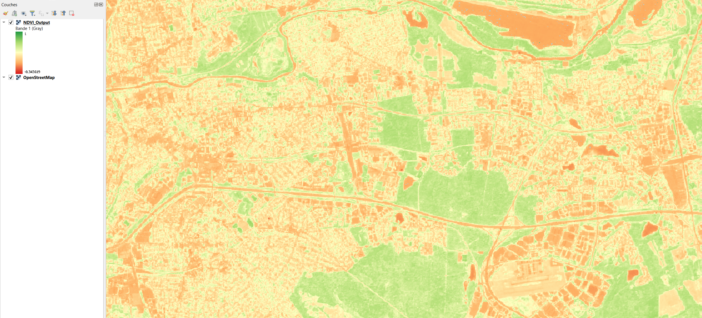

# Sentinel2 NDVI Automation

Script Python permettant d'automatiser le calcul de l'Indice de Végétation (NDVI) à partir de données Copernicus Sentinel-2.

## Aperçu du résultat sur Champs-sur-Marne

## Stack Technique
- **Langage :** Python 3
- **Bibliothèques :** `rasterio`, `numpy`
- **Données :** ESA Sentinel-2 (L2A)

## Utilisation
1. Placer les bandes B04 et B08 dans le dossier `data/`.
2. Installer les dépendances : `pip install -r requirements.txt`
3. Lancer le script : `python calc_ndvi.py`
